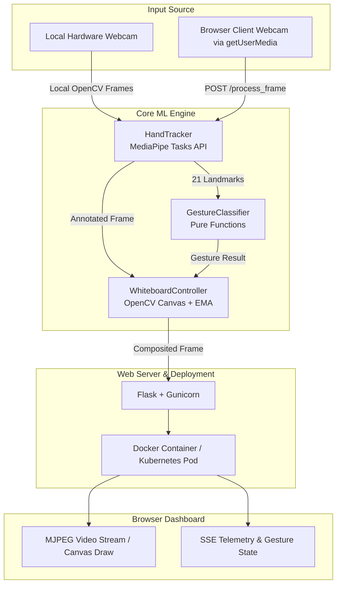

# Air-Drawing Whiteboard — AI-Powered Hand Gesture Canvas


A real-time computer vision system that uses hand gestures detected via webcam to draw directly on an in-memory canvas. Built with a pure-function architecture, responsive glassmorphism UI, dual camera streaming support (server camera or browser webcam), and production deployment support with Docker, Kubernetes, and 100% free cloud hosting.

---

## Features

- **Pure-Function Gestures**: Gesture logic operates on normalized coordinates relative to hand scale, making it fully testable without a camera and invariant to user distance from the webcam.
- **Air Drawing & Color Selection**: Draw with an extended index finger and switch colors (Red, Green, Blue) dynamically based on extended finger counts.
- **Dual Camera Architecture (Cloud & Local Ready)**:
  - **Local Mode**: Uses hardware webcam directly via OpenCV.
  - **Cloud/Container Mode**: Browser captures client webcam via HTML5 `getUserMedia` and streams frames to `/process_frame` via base64, enabling end-to-end functionality when deployed to any remote server or container!
- **Real-Time Web Dashboard**: Flask + Server-Sent Events (SSE) power a responsive glassmorphism UI overlaying the live camera feed without lagging the inference thread.
- **Canvas Compositing**: The drawing surface is managed via OpenCV numpy arrays and composited seamlessly over your webcam feed.
- **Smooth Operation**: Exponential Moving Average (EMA) filtering combined with gesture debouncing prevents stroke jitter and accidental clears.

---

## Architecture



---

## Gesture Reference

| Gesture | Hand Pose | Action |
|---|---|---|
| `DRAW` | Index finger extended only | Draw stroke on canvas |
| `HOVER` | Open palm (5 fingers extended) | Move pen cursor without drawing |
| `CLEAR` | Closed fist (all fingers curled) | Wipes the entire canvas |
| `UNDO` | Thumb tip + Index tip pinch | Trigger Undo Action |
| `SELECT_COLOR` | 2 Fingers = Red \| 3 Fingers = Green \| 4 Fingers = Blue | Select a new color |

---

## Quickstart (Local Python)

```bash
# 1. Clone repository
git clone https://github.com/RoshanYd/Virtual-Board.git
cd Virtual-Board/hand-gesture-mouse

# 2. Setup virtual environment
python -m venv .venv

# Activate venv:
# Windows (PowerShell): .venv\Scripts\Activate.ps1
# Windows (cmd):        .venv\Scripts\activate.bat
# Linux / macOS:        source .venv/bin/activate

# 3. Install dependencies
pip install -r requirements.txt

# 4. Run application
python src/app.py
```
Open **`http://127.0.0.1:5000`** in your browser.

---

## 🐳 Docker Deployment

The application is containerized with a production multi-threaded Gunicorn server and pre-configured system libraries for OpenCV and MediaPipe.

### Build and Run with Docker:
```bash
# Build the Docker image
docker build -t virtual-board:latest .

# Run the container
docker run -d -p 5000:5000 --name virtual-board-app virtual-board:latest
```

### Run with Docker Compose:
```bash
docker compose up -d
```
Access the dashboard at **`http://localhost:5000`**. Click **"📷 Switch to Browser Webcam"** to use your device's camera inside the container!

---

## ☸️ Kubernetes Deployment

Pre-configured Kubernetes manifests are located in the `k8s/` directory.

### Deploy to any Kubernetes Cluster (Minikube, Kind, EKS, GKE, AKS):

```bash
# Apply all manifests using Kustomize
kubectl apply -k k8s/

# Or apply individual manifests:
kubectl apply -f k8s/configmap.yaml
kubectl apply -f k8s/deployment.yaml
kubectl apply -f k8s/service.yaml
kubectl apply -f k8s/ingress.yaml
```

### Verify Deployment:
```bash
kubectl get deployments -l app=virtual-board
kubectl get pods -l app=virtual-board
kubectl get svc virtual-board-service
```

### Port Forwarding for Local Testing:
```bash
kubectl port-forward svc/virtual-board-service 5000:80
```
Open **`http://localhost:5000`** in your browser.

---

## 🚀 100% Free Cloud Deployment

### Option 1: Render.com (Recommended Free Cloud Host)
1. Fork or push this repository to your GitHub account: `https://github.com/RoshanYd/Virtual-Board`
2. Go to [Render.com](https://render.com) and sign in for free with GitHub.
3. Click **New +** -> **Web Service**.
4. Select your **Virtual-Board** repository.
5. Choose **Docker** as the Runtime (or Render will automatically detect `render.yaml`).
6. Select the **Free** instance type.
7. Click **Deploy Web Service**!
Render will build the Docker container and give you a free permanent public HTTPS URL (e.g. `https://virtual-board.onrender.com`). Open the link on any laptop or phone, grant camera permission, and draw!

### Option 2: Hugging Face Spaces (100% Free CPU Hosting)
1. Go to [huggingface.co/spaces](https://huggingface.co/spaces) and create a free account.
2. Click **Create new Space**.
3. Choose **Docker** as the Space SDK and set license to **MIT**.
4. Push or connect this repository.
5. Hugging Face automatically builds the container and provides a live HTTPS URL with zero configuration!

---

## Running Automated Tests

```bash
cd hand-gesture-mouse
pytest tests/ -v
```
All **40 unit tests** pass with 100% synthetic geometry (no physical webcam required).
