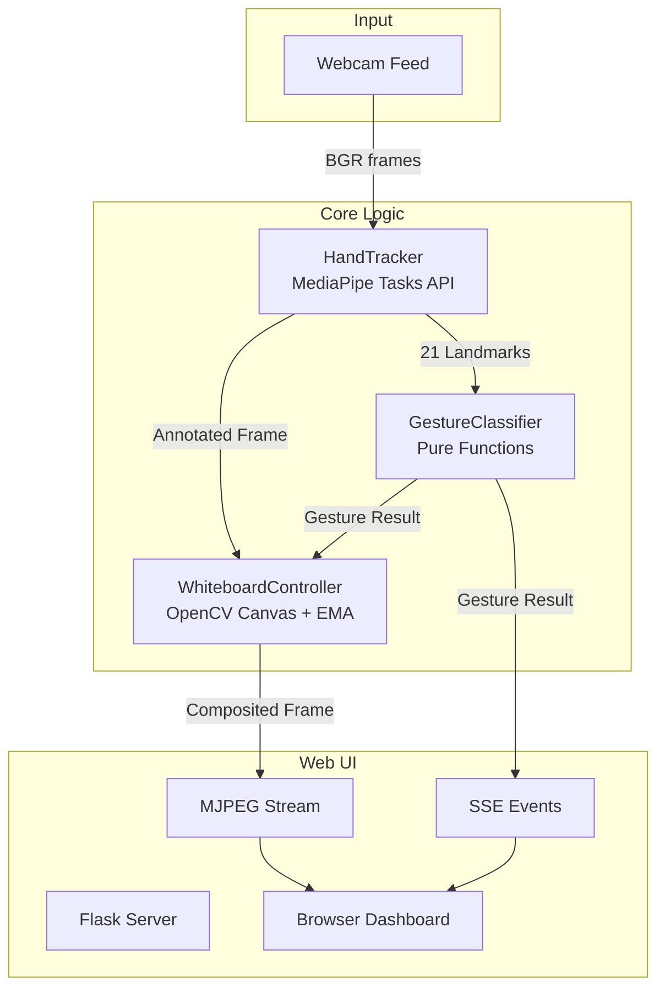

# Air-Drawing Whiteboard — AI-Powered Hand Gesture Canvas


A real-time computer vision system that uses a single webcam to detect a user's hand, tracks landmarks, and maps hand gestures to an in-memory drawing canvas. Built as an evolution of a Virtual Mouse, emphasizing pure-function architecture, responsive UI, and modern ML practices.

---

## Features

- **Pure-Function Gestures**: Gesture logic operates on normalized coordinates relative to hand scale, making it fully testable without a camera and invariant to user distance from the webcam.
- **Air Drawing & Color Selection**: Draw with an extended index finger and switch colors (Red, Green, Blue) dynamically based on extended finger counts.
- **Real-Time Web Dashboard**: Flask + Server-Sent Events (SSE) power a responsive glassmorphism UI overlaying the live camera feed without lagging the inference thread.
- **Canvas Compositing**: The drawing surface is managed via OpenCV numpy arrays and composited seamlessly over your webcam feed.
- **Smooth Operation**: Exponential Moving Average (EMA) filtering combined with gesture debouncing prevents stroke jitter and accidental clears.

---

## Architecture



---

## Setup & Quickstart

### 1. Clone Repository & Setup Virtual Environment
```bash
git clone https://github.com/RoshanYd/Virtual-Board.git
cd Virtual-Board/hand-gesture-mouse
python -m venv .venv

# Activate venv:
# Windows (PowerShell):
.venv\Scripts\Activate.ps1
# Windows (cmd):
.venv\Scripts\activate.bat
# Linux / macOS:
source .venv/bin/activate
```

### 2. Install Dependencies
```bash
pip install -r requirements.txt
```

### 3. Run the Application
```bash
python src/app.py
```

### 4. Open Dashboard
Open your browser and navigate to:
```
http://127.0.0.1:5000
```

---

## Gesture Reference

| Gesture | Hand Pose | Action |
|---|---|---|
| `DRAW` | Index finger extended only | Draw stroke on canvas |
| `HOVER` | Open palm (5 fingers extended) | Move pen cursor without drawing |
| `CLEAR` | Closed fist (all fingers curled) | Wipes the entire canvas |
| `UNDO` | Thumb tip + Index tip pinch | Trigger Undo Action |
| `SELECT_COLOR` | 2 Fingers = Red \| 3 Fingers = Green \| 4 Fingers = Blue | Select a new color |

---

## Running Unit Tests

The test suite covers pure landmark transformations and priority logic using synthetic 21-landmark hand models (no webcam required):

```bash
cd hand-gesture-mouse
pytest tests/ -v
```

All 40 unit tests run and pass in under 1 second.

---

## Performance Evaluation

A benchmark script (`src/benchmark.py`) can be run headless to measure system performance:

```bash
cd hand-gesture-mouse
python src/benchmark.py
```

| Metric | Measured Value |
|---|---|
| Avg Detection Latency | ~13.5 ms |
| Sustained FPS | 30.0+ |
| Accuracy & Stability | EMA filtered & debounced |
