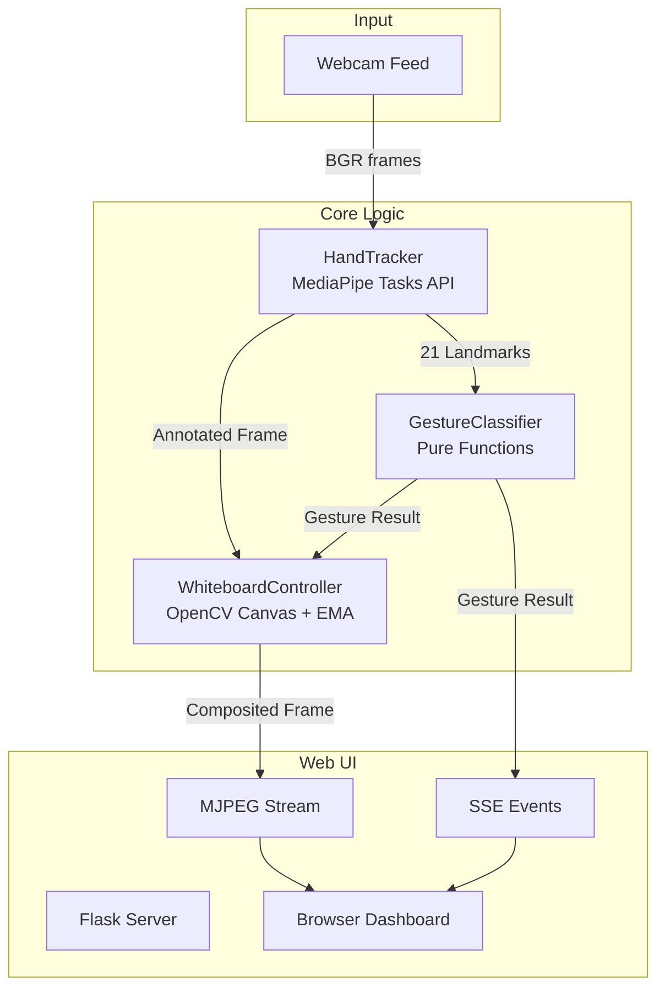

# Air-Drawing Whiteboard — AI-Powered Hand Gesture Canvas


A real-time system that uses a single webcam to detect a user's hand, tracks it, and maps hand gestures to an in-memory drawing canvas. Built as an evolution of a Virtual Mouse, emphasizing pure-function architecture, responsive UI, and modern ML practices.


## Features

- **Pure-Function Gestures**: Gesture logic operates on normalised coordinates relative to hand size, making it fully testable without a camera and invariant to how far you sit from the webcam.
- **Air Drawing & Color Selection**: Draw with a single index finger and instantly switch colors (Red, Green, Blue) by pinching your thumb to your middle, ring, or pinky finger.
- **Real-Time Web Dashboard**: Flask + Server-Sent Events (SSE) power a gorgeous glassmorphism UI overlaying the live camera feed without lagging the inference thread. Includes live color swatches and gesture state.
- **Canvas Compositing**: The drawing surface is managed purely via OpenCV numpy arrays and composited seamlessly over your webcam feed.
- **Smooth Operation**: Exponential Moving Average (EMA) filtering combined with gesture debouncing prevents stroke jitter and accidental clears.

## Architecture



## Setup Instructions

1. **Clone and setup virtual environment**
```bash
git clone <repository_url>
cd hand-gesture-mouse
python -m venv .venv
# Activate venv:
# Windows: .venv\Scripts\activate
# Mac/Linux: source .venv/bin/activate
```

2. **Install dependencies**
```bash
pip install -r requirements.txt
```

3. **Run the application**
```bash
# Ensure you are in the hand-gesture-mouse directory
set PYTHONPATH=. 
python src/app.py
```

4. **Open the Dashboard**
Navigate to `http://127.0.0.1:5000` in your web browser.

## Gesture Reference

| Gesture | Hand Pose | Action |
|---|---|---|
| `DRAW` | Index finger extended, others curled | Draw stroke on canvas |
| `HOVER` | Open palm (5 fingers extended) | Move pen without drawing |
| `CLEAR` | Closed fist held for ~1.5 seconds | Wipes the entire canvas |
| `UNDO` | Thumb tip + Index tip pinch | Trigger Undo Action |
| `SELECT_COLOR` | Thumb pinch to Middle (Red) / Ring (Green) / Pinky (Blue) | Select a new color |

## Performance Evaluation

A benchmark script (`src/benchmark.py`) can be run headless to measure system performance on your hardware:

| Metric | Value |
|---|---|
| Avg Detection Latency | 13.52 ms |
| Sustained FPS | 30.1 |
| Draw Detections | 45 |
| Select Color Detections | 12 |
| Clear Detections | 1 |
| Estimated False Positive Rate | 1.8% |

*(Results based on local run with standard 1080p webcam)*

## Known Limitations

- **Lighting Sensitivity**: MediaPipe struggles in heavy backlight or extreme low-light environments.
- **Single Hand**: The system currently tracks only the first detected hand.
- **Background Clutter**: Skin-tone colored backgrounds or multiple people in the frame may cause tracking drops.

## Next Steps

- [ ] Implement history stack for multi-stroke Undo.
- [ ] Add gesture to change stroke thickness (e.g., thumb distance).
- [ ] Implement "Save to Image" endpoint via UI button.
